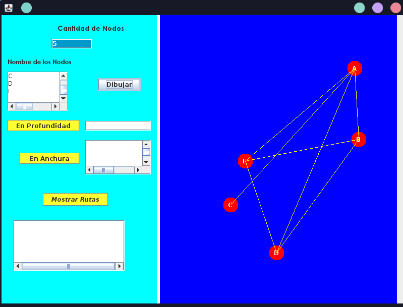

# Grafo y sus Recorridos (DFS, BFS y Rutas Óptimas)

> Aplicación de escritorio desarrollada en **Java Swing** para la creación dinámica, representación gráfica y análisis de grafos estáticos. Implementa estructuras de datos desde cero para realizar recorridos en profundidad, recorridos en anchura y cálculo de todas las rutas posibles junto con la ruta óptima entre dos nodos.

---

##  Demostración Visual

<p align="center">
  
</p>

---

##  Características Principales

* **Generación Dinámica de Grafos:** Configuración interactiva de la cantidad de nodos y asignación de nombres personalizados[cite: 2, 3].
* **Renderizado Gráfico (`Graphics`):** Dibujo automático de vértices y aristas sobre un `JPanel` utilizando coordenadas calculadas con `Math.random()` y matriz de adyacencia[cite: 6, 15].
* **Recorrido en Profundidad (DFS):** Exploración completa del grafo implementando **Pilas Estáticas (LIFO)**[cite: 6, 11, 13].
* **Recorrido en Anchura (BFS):** Exploración por niveles implementando **Colas Estáticas (FIFO)**[cite: 6, 11, 12].
* **Búsqueda de Rutas y Ruta Óptima:** Algoritmo recursivo apoyado con `HashSet` y `ArrayList` para encontrar todos los caminos posibles entre un nodo origen ($X$) y un nodo destino ($Y$), destacando la mejor ruta[cite: 6, 10, 16].

---

##  Tecnologías y Estructuras Utilizadas

* **Lenguaje:** Java (JDK)
* **Interfaz Gráfica:** Java Swing (`JFrame`, `JPanel`, `JTextArea`, `JTextField`, `JButton`)[cite: 3, 6]
* **Estructuras de Datos (Implementación Propia):**
  * **Matriz de Adyacencia y Arreglos:** Almacenamiento de conexiones y nombres de nodos[cite: 6, 8].
  * **Pila Estática (`Pila.java`):** Control de nodos visitados en DFS[cite: 6, 7, 13].
  * **Cola Estática (`Cola.java`):** Control de nodos visitados en BFS[cite: 6, 7, 12].
* **Colecciones de Java:** `ArrayList` y `HashSet` para gestión de rutas y prevención de ciclos infinitos[cite: 6, 10].

---

## Arquitectura del Proyecto

El código fuente dentro del paquete `Proyecto` se estructura en las siguientes clases:

* `VentanaGrafo.java`: Interfaz gráfica principal (`JFrame`) y manejo de eventos de usuario[cite: 7].
* `GrafoEstatico.java`: Lógica central del grafo, matriz de adyacencia, algoritmos de recorrido (`profundidad`, `anchura`) y cálculo de rutas (`Rutas`, `RutasDFS`)[cite: 7, 8, 9, 10, 11].
* `Pila.java`: Estructura de datos estática tipo LIFO[cite: 7, 13].
* `Cola.java`: Estructura de datos estática tipo FIFO[cite: 7, 12].

---

## ⚙️ Cómo Ejecutarlo Localmente

1. **Clonar el repositorio:**
   ```bash
   git clone [https://github.com/tu-usuario/nombre-de-tu-repo.git](https://github.com/tu-usuario/nombre-de-tu-repo.git)
